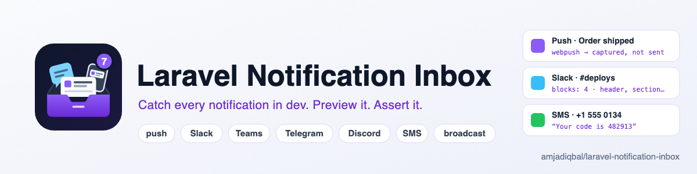
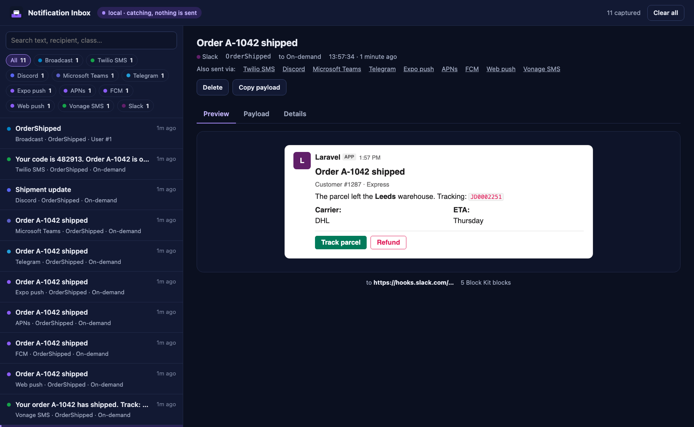

<p align="center">
  <picture>
    <source media="(prefers-color-scheme: dark)" srcset="art/banner-dark.png">
    
  </picture>
</p>

# Laravel Notification Inbox: catch and preview push, Slack, Teams, Telegram, Discord and SMS notifications

Mailpit catches your mail. Nothing catches the rest. In local and staging, this package stops every
**non-mail Laravel notification** before it is sent (web push, FCM, APNs, Expo, Slack, Microsoft Teams,
Telegram, Discord, Twilio and Vonage SMS, broadcast) and shows each one in a single inbox as it would look
on the other end: a push alert on a phone lock screen, a Slack Block Kit message, a Teams Adaptive Card, a
Telegram bubble with its buttons, a Discord embed, an SMS thread with its segment count.

It builds every message with the channel's own `toX()` method and route, exactly as the real channel
would, so your tests can assert against the **real payloads**, and a notification that would crash in
production crashes here first.

Docs and demo: https://amjad.com.pk/laravel/packages/laravel-notification-inbox

[](https://packagist.org/packages/amjadiqbal/laravel-notification-inbox)
[](https://packagist.org/packages/amjadiqbal/laravel-notification-inbox)
[](LICENSE.md)

<p align="center">
  
</p>

```bash
composer require amjadiqbal/laravel-notification-inbox --dev
```

That is the whole setup. Send a notification, then open `/notification-inbox`.

> Installing with `--dev` keeps it off production servers that run `composer install --no-dev`. If your
> staging server installs without dev packages and you want the inbox there, require it normally: the
> [environment allow-list](#safety-it-cannot-catch-production-by-accident) keeps it off in production.

## Contents

- [What it catches](#what-it-catches)
- [Safety: it cannot catch production by accident](#safety-it-cannot-catch-production-by-accident)
- [The inbox](#the-inbox)
- [Testing against real payloads](#testing-against-real-payloads)
- [Configuration](#configuration)
- [Your own channels](#your-own-channels)
- [Personal data and retention](#personal-data-and-retention)
- [FAQ](#faq)

## What it catches

| Channel | Package | Preview |
|---|---|---|
| Web push | `laravel-notification-channels/webpush` | Phone lock-screen alert with actions |
| FCM, FCM topic | `laravel-notification-channels/fcm` | Phone alert with image |
| APNs, APNs VoIP | `laravel-notification-channels/apn` | Phone alert with subtitle and app badge |
| Expo | `laravel-notification-channels/expo` | Phone alert with badge |
| OneSignal, Pushover | `laravel-notification-channels/onesignal`, `/pushover` | Phone alert |
| Google Chat | `laravel-notification-channels/google-chat` | The payload as JSON (no look-alike yet) |
| Slack | `laravel/slack-notification-channel` (Block Kit and legacy attachments) | Slack message: header, sections, fields, context, dividers, images, buttons |
| Microsoft Teams | `laravel-notification-channels/microsoft-teams` | Adaptive Card (and the legacy MessageCard) |
| Telegram | `laravel-notification-channels/telegram` | Chat bubble with Markdown or HTML, media, inline keyboard |
| Discord | `laravel-notification-channels/discord` | Message with embeds, fields and buttons |
| Twilio, Vonage, MessageBird, Plivo, AWS SNS | their channel packages | SMS thread with GSM-7 / UCS-2 encoding and segment count |
| Broadcast | Laravel | Channels, event name, data and the matching Echo listener |
| Anything else | your channel | The payload as JSON, or [map it to a preview](#your-own-channels) |

`mail` and `database` are **not** caught: mail already has Mailpit, Herd and friends, and the database
channel only writes to your own database. Both lists are configurable.

Non-mail notification channels are caught instead of sent. Laravel fires `NotificationSending` before
it even resolves a channel's driver, and the inbox cancels the send right there, so the channel's HTTP
client, SDK and credentials are never touched. Queued notifications are caught in the worker the same way.

What still runs is your own code: the inbox calls your `toX()` and `routeNotificationFor…()` methods to
build each message, exactly as the channel would, so anything those methods do themselves (an HTTP call to
shorten a link, say) still happens. Mail and database notifications are passed through and sent as usual.

## Safety: it cannot catch production by accident

A notification catcher left on in production silently swallows every message your users should get. So:

- **Environment allow-list.** It only runs in the environments you list. The default is `local` only.
  Add staging with `NOTIFICATION_INBOX_ENVIRONMENTS=local,staging`.
- **Production needs two switches.** Listing `production` alone does nothing (and logs a warning when
  artisan runs there). It also needs `NOTIFICATION_INBOX_ALLOW_PRODUCTION=true`. With both set, it logs a
  warning on every request, `php artisan about` says so in red, and the inbox shows a red banner.
- **The dashboard is behind a gate.** `viewNotificationInbox` only opens in `local` by default. Where the
  inbox is off, its routes do not exist at all (404).
- **It fails closed.** While the inbox is on, a notification is never sent, even if storing it fails
  (that is logged instead).
- **It never halts other listeners.** For channels it lets through, its `NotificationSending` listener
  returns `null`, so your own listeners and other packages keep working.
- **It runs first.** Laravel stops at the first `NotificationSending` listener that returns something, so
  the inbox registers its listener while the app is still registering services, ahead of every listener
  added in a service provider's `boot()` and the app's own. Only a package that adds a listener in its own
  `register()`, earlier than this one, could still decide first; if such a listener returns `true` or
  `false`, that wins.
- **Looking is not deleting.** Delete and Clear all need a second gate, `manageNotificationInbox`, which
  also only opens in `local` by default.

To open the dashboard on staging, define the gate in `AppServiceProvider::boot()`:

```php
use Illuminate\Support\Facades\Gate;

Gate::define('viewNotificationInbox', fn ($user) => $user?->is_admin);
Gate::define('manageNotificationInbox', fn ($user) => $user?->is_admin);   // delete and clear
```

## The inbox

Open `/notification-inbox` (configurable).

- New notifications appear without a reload.
- Filter by channel, or search the text, recipient and notification class.
- Each notification has three tabs: **Preview**, **Payload** (the data the channel would have sent) and
  **Details** (notification and message class, notifiable, route, queued or not, notification id).
- "Also sent via" links the same notification on its other channels.
- Previews flag real problems: an SMS that splits into several billed segments, or switched to UCS-2
  because of one emoji; a push with no title or body; a Slack message with no fallback text; a Telegram or
  Discord message over the length limit.
- If a `toX()` method throws, the inbox shows the exception instead of a preview, because the real channel
  would have failed too.

Delete one, or clear all. Light and dark mode follow your system. There is no JavaScript build: one Blade
view with inline CSS, so there is nothing to publish.

## Testing against real payloads

`Notification::fake()` never calls your `toX()` methods, so a broken Slack block or a missing chat id
passes your tests. `NotificationInbox::fake()` lets Laravel build every message for real, keeps it in
memory, and gives you assertions on the result:

```php
use AmjadIqbal\NotificationInbox\Facades\NotificationInbox;

it('tells the customer their order shipped', function () {
    NotificationInbox::fake();

    $user->notify(new OrderShipped($order));

    NotificationInbox::assertCaptured(OrderShipped::class)
        ->assertCapturedOn('telegram', fn ($n) => str_contains($n->body(), 'A-1042'))
        ->assertCapturedFor($user)
        ->assertCapturedFor('+447700900123')            // a route: phone number, chat id, channel id
        ->assertCapturedContaining('Track parcel', 'slack')
        ->assertNoCaptureErrors();                      // every toX() built without throwing
});
```

| Assertion | Passes when |
|---|---|
| `assertCaptured(Notification::class, ?callback)` | at least one matches |
| `assertCaptured(Notification::class, 2)` or `assertCapturedTimes(...)` | exactly that many, across channels |
| `assertNotCaptured(Notification::class, ?callback)` | none match |
| `assertNothingCaptured()`, `assertCapturedCount(3)` | totals |
| `assertCapturedOn('slack', ?callback)`, `assertNotCapturedOn(...)` | by channel: alias, short name or channel class |
| `assertCapturedFor($user or '+1555…', ?callback)` | by notifiable model or route |
| `assertCapturedContaining('text', ?channel)` | the title or body contains the text |
| `assertNoCaptureErrors()` | no `toX()` threw |

Callbacks receive a `CapturedNotification` with `title()`, `body()`, `text()`, `buttons()`, `preview()`
(the normalised fields), `payload` (the raw data), `route`, `channel`, `notifiable` and more. To dig in
yourself, `NotificationInbox::captured(OrderShipped::class)` returns a collection and
`NotificationInbox::first(...)` the first match. A failing assertion lists what *was* captured.

`fake()` works in any environment, including `testing`, and never writes to disk.

## Configuration

Everything works without publishing the config. To change it:

```bash
php artisan vendor:publish --tag=notification-inbox-config
```

| Key | Env | Default |
|---|---|---|
| `enabled` | `NOTIFICATION_INBOX_ENABLED` | `true` |
| `environments` | `NOTIFICATION_INBOX_ENVIRONMENTS` (comma-separated) | `local` |
| `allow_production` | `NOTIFICATION_INBOX_ALLOW_PRODUCTION` | `false` |
| `intercept` | | `['*']`: every channel, or a list of aliases, short names or classes |
| `pass_through` | | `['mail', 'database']`: always sent normally |
| `channels` | | your own channel definitions, below |
| `storage.path` | `NOTIFICATION_INBOX_PATH` | `storage/notification-inbox` |
| `retention_hours` | `NOTIFICATION_INBOX_RETENTION_HOURS` | `72` |
| `max_messages` | `NOTIFICATION_INBOX_MAX_MESSAGES` | `1000` |
| `redact` | | exact key names masked before storing: `auth`, `authorization`, `p256dh`, `api_key`, `apikey` |
| `redact_containing` | | keys containing any of these are masked: `password`, `passcode`, `secret`, `token`, `otp`, `code`, `private_key`, `webhook` |
| `mask_codes_in_text` | `NOTIFICATION_INBOX_MASK_CODES` | `false`; `true` masks 4 to 8 digit numbers inside message text |
| `dashboard.enabled` | `NOTIFICATION_INBOX_DASHBOARD` | `true` |
| `dashboard.path` | `NOTIFICATION_INBOX_DASHBOARD_PATH` | `notification-inbox` |
| `dashboard.middleware` | | `['web']` (the gates are always added) |
| `dashboard.poll_seconds` | | `3`; `0` turns live updates off |

`php artisan about` shows whether the inbox is catching notifications in the current environment.

## Your own channels

An unknown channel is caught too. The inbox guesses the Laravel convention from its class name
(`App\Channels\WhatsAppChannel` calls `toWhatsApp()` and routes with `whatsApp`) and shows the payload as
JSON. To get a look-alike preview, tell it how your channel works:

```php
// config/notification-inbox.php
'channels' => [
    App\Channels\WhatsAppChannel::class => [
        'label' => 'WhatsApp',
        'method' => 'toWhatsApp',  // what your channel calls on the notification
        'route' => 'whatsapp',     // the routeNotificationFor() key it reads
        'preview' => 'sms',        // push, slack, teams, telegram, discord, sms, broadcast or json
    ],
],
```

## Personal data and retention

Captured notifications contain whatever your notifications contain: phone numbers, one-time codes,
password-reset links. So:

- Each one is stored as a JSON file in `storage/notification-inbox`, with a `.gitignore` so they never end
  up in git. Nothing goes into your database and there is no migration.
- The notifiable is stored as its type, key and a label (`User #42`), never its attributes.
- Before writing, keys named in `redact` and keys containing a word from `redact_containing`
  (`reset_token`, `otp_code`, `client_secret`…) are masked, and webhook routes (Slack, Teams, Discord) keep
  only their host, because the path of a webhook URL is its secret.
- One-time codes *inside the message text* ("Your code is 482913") are stored as they are unless you set
  `NOTIFICATION_INBOX_MASK_CODES=true`, which masks every 4 to 8 digit number in the text (order numbers and
  prices too, which is why it is off by default). Turn it on for shared staging servers.
- `NotificationInbox::fake()` keeps everything in memory and unredacted, so tests can assert on it.
- Pruning is opportunistic: about one capture in fifty also deletes notifications older than
  `retention_hours` and the oldest beyond `max_messages`. A quiet inbox is therefore not pruned on its own,
  so on a shared staging server schedule the prune command:

```php
// routes/console.php
Schedule::command('notification-inbox:prune')->hourly();
```

| Command | Does |
|---|---|
| `php artisan notification-inbox:prune` | deletes everything older than `retention_hours` (or `--hours=6`) |
| `php artisan notification-inbox:clear` | deletes everything |

## FAQ

**Does it replace Mailpit?** No. Mail passes straight through to whatever catches it today. This covers
every other channel.

**Telescope already records notifications.** Telescope records that a notification was sent, and still
sends it. This stops it and shows what would have arrived.

**Do I need the channel packages installed?** Only the ones your app uses. The inbox catches the send
before Laravel resolves the channel, so you can preview a channel whose credentials are not configured yet.

**Can it resend a caught notification for real?** Not in this version. Rebuilding a notification safely
outside its original request needs its constructor arguments, which are not stored.

**Does it work with queued notifications and Horizon?** Yes. The worker builds the message and the inbox
catches it there; the Details tab shows it was queued.

## Need this built into your app, or something custom?

I build Laravel packages and notification flows: push, SMS, Slack and Teams alerts, Telegram and Discord
bots, and the queues behind them. If you need a custom channel, or this wired into your app,
[get in touch](https://amjad.com.pk/contact?utm_source=github&utm_medium=readme&utm_campaign=laravel-notification-inbox).

## Support

- 🐛 **Bug or feature request**: [open an issue](https://github.com/amjadiqbal/laravel-notification-inbox/issues)
- 🔒 **Security issue**: please report privately via GitHub's security tab

## More packages

Part of a family of open-source packages. See [all of them](https://github.com/amjadiqbal?tab=repositories).

| | |
|---|---|
| [laravel-mysql-advisor](https://github.com/amjadiqbal/laravel-mysql-advisor) | MySQL and MariaDB health checks with the SQL to fix each one |
| [kiln](https://github.com/amjadiqbal/kiln) | Deploy-time OPcache control for Laravel |
| [refresher](https://github.com/amjadiqbal/refresher) | Cache your test DB schema, skip `migrate:fresh` on every test run |
| [laravel-driver-js](https://github.com/amjadiqbal/laravel-driver-js) | Product tours and onboarding for Laravel |

## Changelog

See [CHANGELOG.md](CHANGELOG.md).

## License

MIT. See [LICENSE.md](LICENSE.md). Slack, Microsoft Teams, Telegram, Discord, Twilio, Vonage, Firebase,
Apple Push Notification service and Expo are trademarks of their owners. This package is independent, not
affiliated with any of them, and its previews are approximations drawn without their logos.
